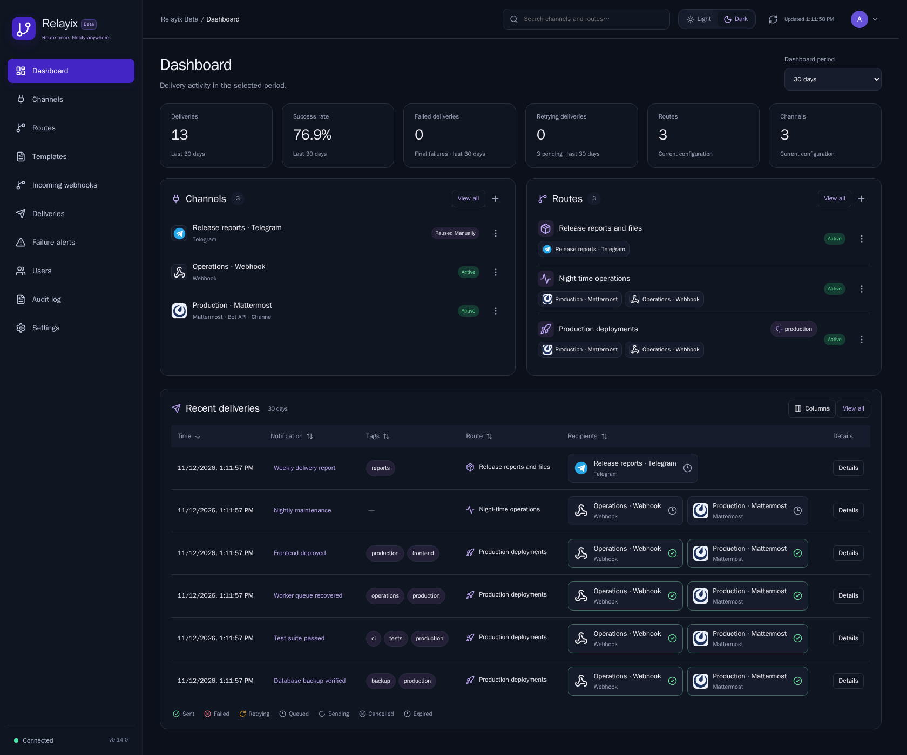
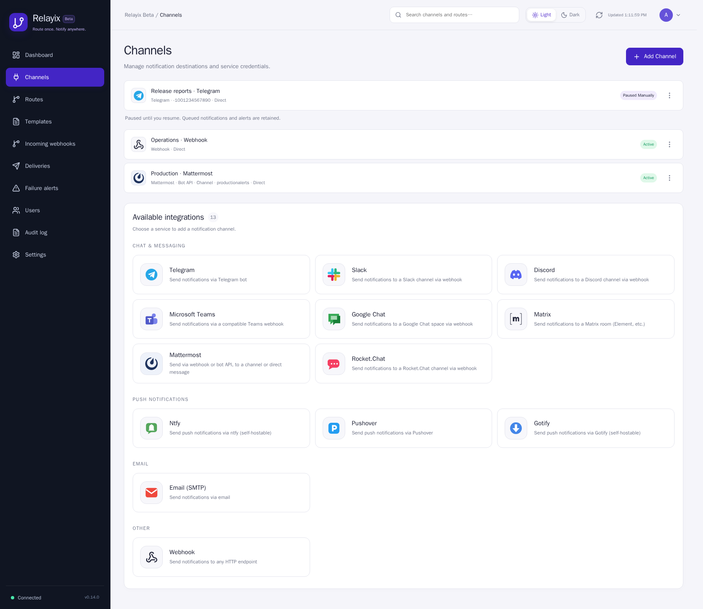
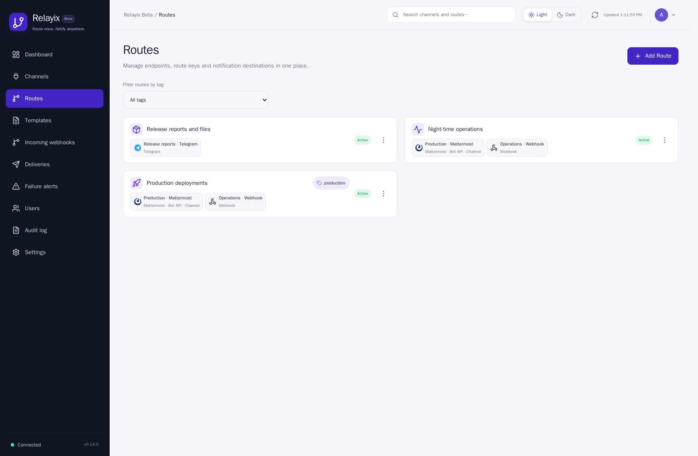
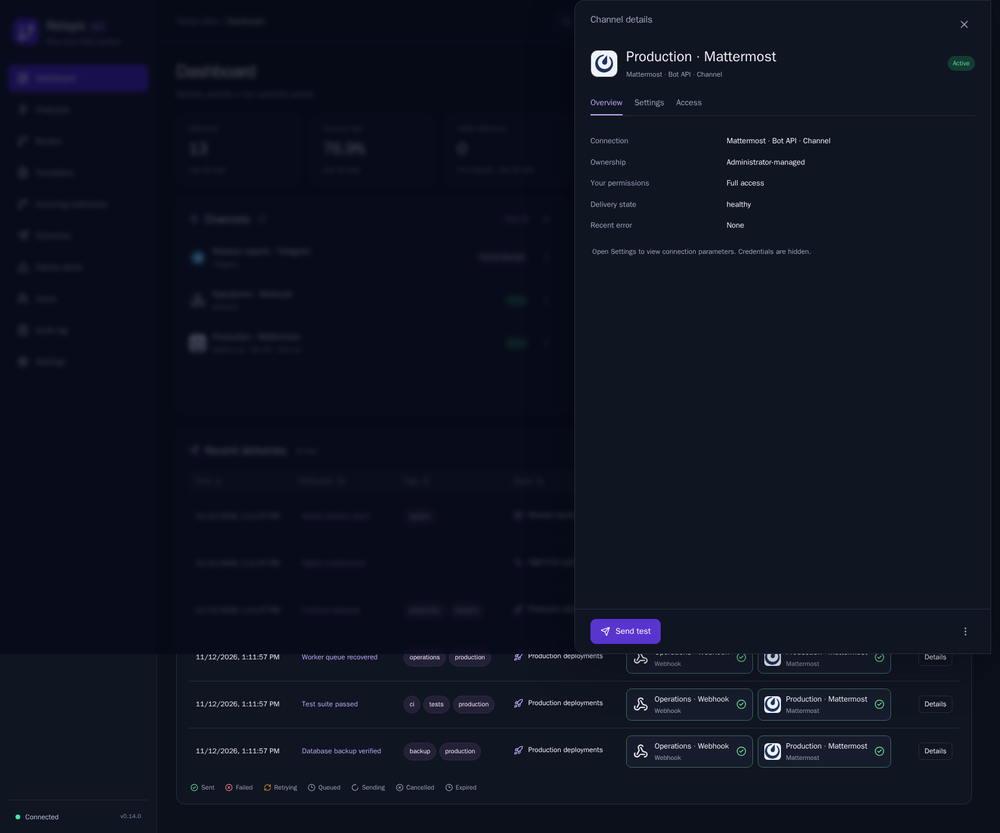
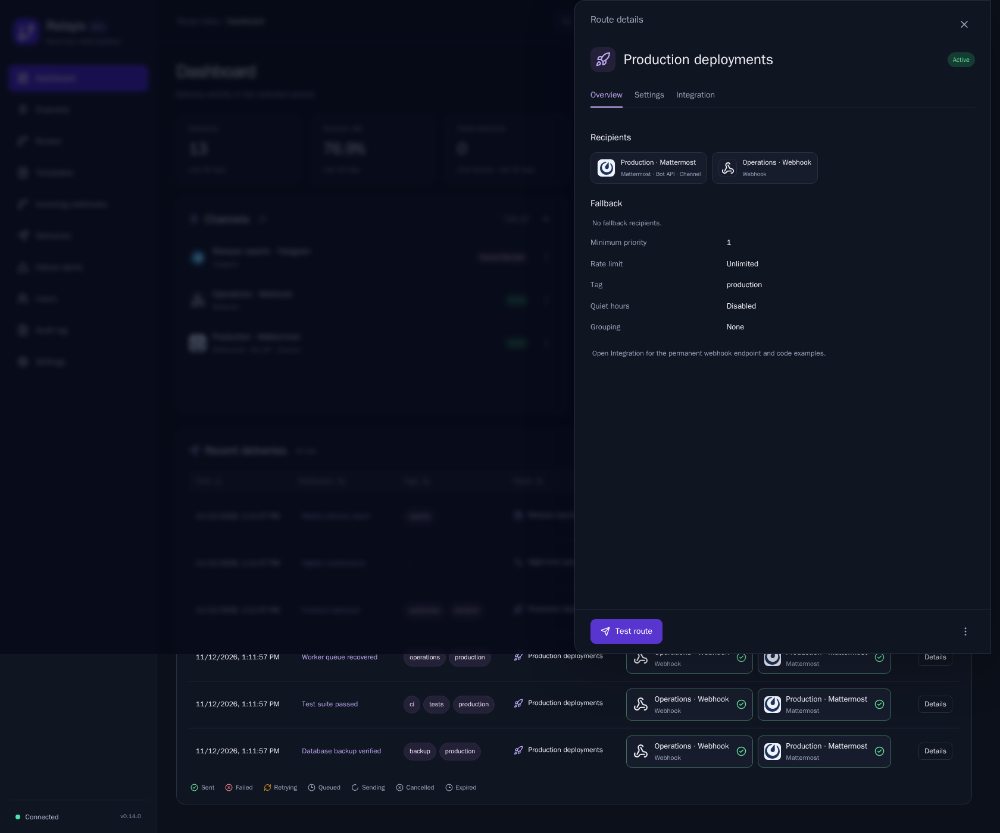
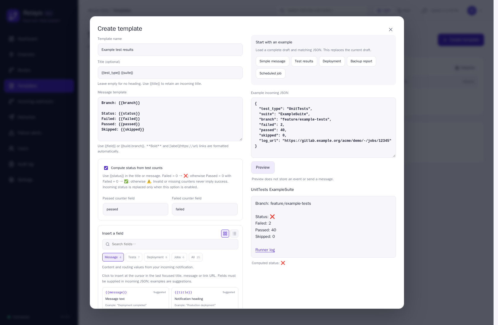
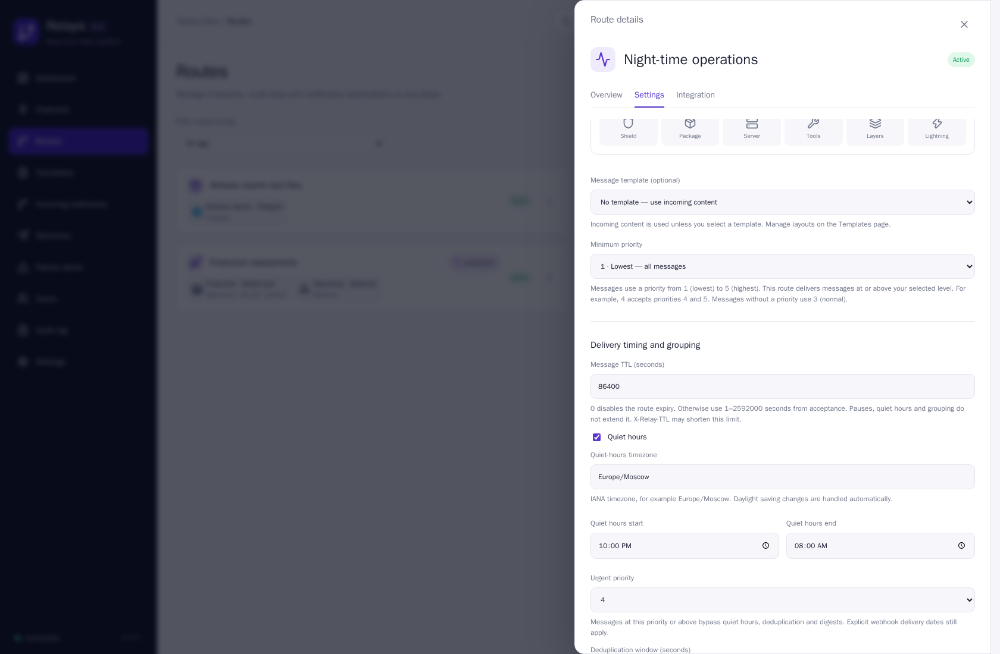
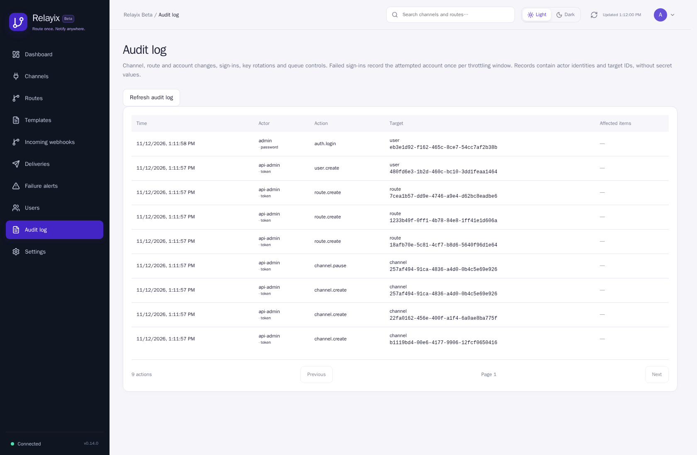

<p align="center">
  <picture>
    <source media="(prefers-color-scheme: dark)" srcset="docs/brand/relayix-header-dark.svg">
    <source media="(prefers-color-scheme: light)" srcset="docs/brand/relayix-header-light.svg">
    
  </picture>
</p>

Relayix receives webhooks and delivers notifications to your messengers and services. Self-hosted, with delivery history, retries and fallback recipients.

## Features

- 13 integrations, including Telegram, Mattermost, Slack, Discord, Matrix and email.
- One webhook for multiple recipients, with optional titles, tags and priority.
- Native files and standalone documents for Telegram and Mattermost bot/API, with durable private attachment history.
- Automatic Telegram and Mattermost formatting for bold text and links.
- Delivery history, per-channel diagnostics, retries and fallback recipients.
- Message templates with categorized JSON fields, computed test status, preview and version history.
- Route payload validation, cloning, bulk retry and personal delivery failure alerts.
- Light and dark themes, shared channels and individual user accounts.

## Quick start

Requires Git and Docker Compose v2.20+.

```bash
git clone https://github.com/opsforge89/Relayix.git
cd Relayix
cp relayix.env.example .env
```

Edit `.env`: set `POSTGRES_PASSWORD` and `ADMIN_PASSWORD`. The administrator password needs 12–128 characters with uppercase, lowercase, a number and a symbol. Then run:

```bash
chmod 600 .env
docker compose up -d
```

Open **http://127.0.0.1:8080** and sign in as **admin** with your chosen password. Compose downloads the published image and starts the app and PostgreSQL. No build is required. The port is bound to localhost; see [HTTPS and remote access](docs/DEPLOYMENT.md#https-with-caddy) for a server installation.

**External PostgreSQL:** in the same `.env`, set `DATABASE_MODE=external` and your `POSTGRES_HOST`, `POSTGRES_PORT`, `POSTGRES_USER`, `POSTGRES_DB` and `POSTGRES_PASSWORD`. Set `POSTGRES_SSLMODE=disable` without TLS or `verify-full` with TLS; `POSTGRES_CA_PATH` is optional. Use the same Compose command. [Database examples →](docs/DEPLOYMENT.md)

## Send a notification

Create a channel, then a route with your recipients. Copy the route endpoint and key:

```bash
curl 'https://YOUR_RELAYIX/h/YOUR_ROUTE' \
  -H 'Content-Type: application/json' \
  -H 'X-Relay-Key: YOUR_ROUTE_KEY' \
  -d '{"message":"**Tests passed**"}'
```

The minimum payload is `{"message":"..."}`. Add an optional `title` and/or `tags` when needed:

```json
{"message":"**Tests passed**","title":"Deployment","tags":["deploy"]}
```

`tags` is an array of labels, even for a single tag. Relayix handles Telegram and Mattermost formatting automatically.

## Update

Release image: `ghcr.io/opsforge89/relayix:0.14.0`.

Change the app image tag in `compose.yaml`, then run:

```bash
docker compose pull app
docker compose up -d --no-deps app
```

Keep your `.env` and database volume. Migrations run automatically. For upgrades to 0.8.5, use the updated `compose.yaml` and [recreate the fixed bridge without deleting volumes](docs/DEPLOYMENT.md#trusted-reverse-proxies-084). Remove old empty/stale `TRUSTED_PROXIES` assignments to use the stable gateway default; keep explicit addresses for other proxy setups.

## Preview

Current interface, captured from the verified 0.14.0 Beta runtime with fictional demonstration data.







<details>
<summary>Channel and route details</summary>





</details>

<details>
<summary>Templates, delivery timing and administrator audit</summary>







</details>

## Documentation

[Message TTL, audit and encrypted recovery](docs/REFERENCE.md#message-lifetime-audit-and-encrypted-recovery) · [Master-key rotation](docs/REFERENCE.md#rotate-the-credential-master-key) · [Full encrypted backup](docs/REFERENCE.md#full-password-encrypted-backup)

[Integration capabilities and limits](docs/REFERENCE.md#integration-capabilities-and-message-limits) · [Delivery controls](docs/REFERENCE.md#delivery-controls) · [Optional TOTP](docs/REFERENCE.md#optional-two-factor-authentication) · [Message previews](docs/REFERENCE.md#message-previews) · [Retries and channel recovery](docs/REFERENCE.md#retries-and-channel-recovery)

[Setup](docs/DEPLOYMENT.md) · [User guide and API](docs/REFERENCE.md) · [Proxies](docs/PROXIES.md) · [GitHub and CI](docs/GITHUB.md) · [Changelog](CHANGELOG.md) · [Contributing](CONTRIBUTING.md)

## License

[Apache-2.0](LICENSE). See [third-party notices](THIRD_PARTY_NOTICES.md) for dependencies and service icons.

Channel and route names open detail drawers with settings, access controls or integration examples. The `⋯` menu contains secondary actions; both lists remain visible on the dashboard.

Personal channels support independent View, Edit and Send permissions. Administrators retain access to all channels; see [access rights and upgrade behavior](docs/REFERENCE.md#personal-channels-and-access-rights).
