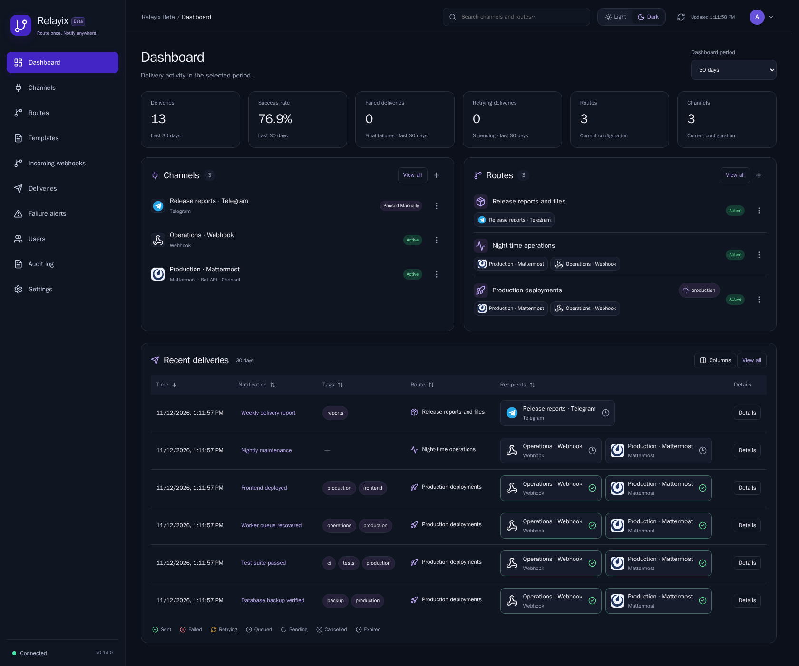
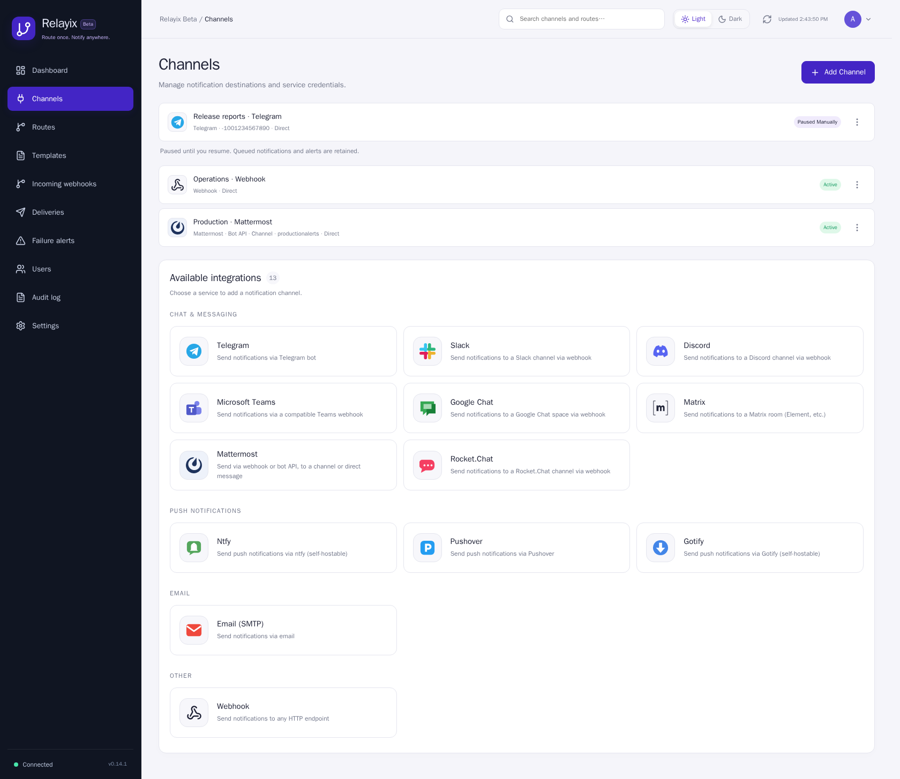

# User and API reference

[Quick start](../README.md) · [Database setup](DEPLOYMENT.md)

## Incoming events and delivery operations

**Incoming webhooks** shows accepted events even when `queued` is zero. Filter by route, routing result or title/message text and inspect the original routing report. Older events remain visible with a legacy diagnostic label. Invalid requests and failed authentication are not stored as events.

In **Routes → Test webhook**, **Preview routing** shows which recipients would receive a payload without storing an event or sending messages. **Send test webhook** creates real deliveries. Optional priority defaults to 3; tags remain UI metadata only.

Click **Details** in its own column in **Deliveries** to inspect errors and start/finish times. **Retry now** starts another cycle of up to five attempts while preserving total attempts and history. A recovered worker lease is marked interrupted because the previous send outcome may be unknown. Older attempts made before this release have counts but no detailed records.

Select **Fallback recipients** when editing a route. After any primary delivery exhausts five attempts, Relayix queues the original message to each enabled fallback recipient. Fallback targets are captured when the event is accepted; each recipient is queued once per event, even if several primary recipients fail or a primary is manually retried. Fallback deliveries have their own five attempts and cannot trigger another fallback. Primary and fallback recipients must be different. Disabling a channel prevents pending sends and fallback dispatch to it. A delivery already in progress can still complete.

For safe webhook retries, send `Idempotency-Key: YOUR_UNIQUE_EVENT_KEY`. The key is scoped to the route and retained with the event. Repeating a key with the same JSON payload returns the original event ID, original queue count and `duplicate: true`, without new deliveries. Reusing a key with a different payload returns `409 Conflict`. Concurrent retries are serialized. JSON object key order does not matter; changes to values or optional fields count as a different payload. Keys contain 1–256 characters and are stored as hashes. Deleting the event or its route removes its deduplication record. Delivery retries remain at least once; an external receiver may receive a duplicate after a crash or an ambiguous network failure.

Click **Diagnose** on any channel to check only that integration, without opening a separate dialog or sending a notification. The channel form also checks draft settings. Results appear inline: green confirms a stage, red reports failure, and gray means a check does not apply or needs an actual test send. Checks respect the configured proxy without direct fallback. Telegram checks bot/chat access; Mattermost and Matrix use read-only account/destination APIs; Discord reads webhook metadata; Pushover validates application/user keys; ntfy and Gotify check service health; SMTP connects/authenticates and issues NOOP. Webhook-only services check connectivity/TLS and leave credential/posting checks explicitly unverified. Use **Test** for actual delivery and topic/write permissions. MTProto/WEB require Telegram application credentials on the server; HTTP Bot API does not.

Startup errors name invalid settings and distinguish database authentication, missing databases, TLS and connection problems without printing credentials. Inspect them with `docker compose logs app`.

## Grouped delivery history

Dashboard and Deliveries show one row per event. Each recipient chip displays the configured channel name, service icon/name and a status: sent, failed, retrying, queued or sending. Click a chip to inspect that delivery; Details summarizes all recipients and their attempt counts. Fallback recipients are labeled separately.

Channel and status filters must match the same delivery. For example, Telegram + Failed selects events where that Telegram channel failed. All recipients remain visible; matching recipients are highlighted and others are muted. Search also matches errors and channel names on that same delivery. Date/period filters use event creation time. Counts and pagination refer to complete events, sorted before pagination; dashboard metrics still count individual deliveries.

`GET /api/deliveries?group_events=true` returns event rows with a `recipients` array and `matches_filter` flags. Without this parameter the existing per-delivery API remains available. The grouped sort columns are `created_at`, `title`, `tags`, `route` and `recipients` (case-insensitive channel-name order). Original message bodies are stored and copied without alteration; the viewer renders the shared bold/link syntax as safe React elements, with raw HTML kept literal.

## Table controls

Every table has a **Columns** menu to show or hide individual columns. Click a text, numeric or time header to sort; click it again to reverse the order. Time-based tables start with newest records first. Sorting of incoming events, deliveries and alert history runs on the server before pagination or result limits. User rows are sorted across the complete loaded user list. Action-only columns do not sort.

Column visibility and sorting are saved per table to your account and follow you across sessions/devices. **Reset table** restores all columns and newest-first ordering. At least one column stays visible. Attempt counts, errors and retry actions are available in **Details**; there is no Attempts column.

To configure fallback delivery, open **Routes → Edit → Fallback delivery → Fallback recipients (optional)**. Select recipients and save. They receive the original message after a primary recipient exhausts five attempts. A route card shows configured fallback recipients separately.

## Screenshots

The screenshots use demonstration data and show the current interface.

### Dashboard · dark theme



### Channels and integrations · light theme



## Runtime and dependencies

Application, build and test images use Debian 13 Trixie. The verified toolchain is Rust 1.99.1, Node.js 26.13.0 LTS and Python 3.15.2; PostgreSQL uses the maintained 17.11 release on Trixie. Debian packages are upgraded from stable repositories during application/test image builds. Cargo, npm and Python dependencies are locked, and Python packages retain mandatory artifact hashes.

The November 2026 refresh includes React 19.3.1, Vite 8.3.6, Lucide 1.69.0, SQLx 0.9.0, Reqwest 0.13.5, Argon2 0.6.0 and rand 0.10.3. Keep the existing database image and data volume when updating the app. `RELAYIX_DB_VOLUME` selects an existing named data volume; keep that setting in the private deployment JSON for installations managed by the deployment scripts.

## Accounts and profiles

- Username/password login with Argon2id password hashes and salted passwords.
- Passwords must contain 12–128 characters, uppercase/lowercase letters, a number and a symbol. Usernames and common sequences (`password`, `qwerty`, `123456`, `letmein`) are rejected in passwords. The UI shows requirements; the API enforces them too.
- Administrators create/edit/delete users, set roles, disable accounts and reset passwords. The last active administrator and your own administrator account are protected from removal/demotion.
- Members can manage shared channels, routes and deliveries. This is one shared notification hub, not isolated workspaces per user.
- The account button opens a menu with the real user's name, profile, settings and sign out. Profile supports display name and password changes.
- Password changes revoke other sessions. Administrative resets and disabling a user revoke all their sessions.
- Sessions expire after seven days. Session tokens are hashed in PostgreSQL. Browser cookies are HttpOnly and SameSite=Strict. Cookie-authenticated API requests require `X-Relay-Client: web`; no cross-origin API access is enabled.
- `COOKIE_SECURE=true` enables Secure cookies behind HTTPS. Leave false for direct HTTP access on the configured LAN IP.
- The optional administrator API token remains available for automation and token login. It is not an individual user's profile.
- Login attempts are limited to ten failures per username in fifteen minutes.

## Personal settings

In **My profile → Interface notifications**, set auto-close to 1–300 seconds (default 8), or 0 for manual dismissal. Success and error banners always have a close button, including inside dialogs. Timers pause on hover or keyboard focus. This setting belongs to the account and follows it across devices.

Settings belong to the authenticated account and are stored in PostgreSQL. Theme, automatic refresh interval, saved delivery filters (including tags), route tag filter, list search and delivery page size follow the user between browsers and devices. Another account has its own preferences. The administrator API-token identity has separate preferences.

Use **Settings → Notification monitoring** to set a custom refresh interval from 5 to 3600 seconds; `0` disables automatic refresh. Manual Refresh remains available. Choose 10, 25, 50 or 100 deliveries per page. Theme and applied filters save automatically; monitoring settings use **Save settings**. Saving errors are shown and can be retried. Pending changes are flushed before sign out.

## Dashboard and Refresh

Choose 5, 15 or 30 minutes, 1 hour, 1 day, 7 days or 30 days. The selected window applies to every delivery metric and recent delivery history, and follows failed/retrying links into Deliveries. The period is saved to your account. Routes and Channels show current configuration counts.

The dashboard displays final failed deliveries, deliveries being retried, pending deliveries, total deliveries and success rate for the selected period. Clicking failed/retrying counts opens the corresponding delivery filter.

Refresh makes uncached requests, shows progress, updates the last refresh time and reports success or errors. Successful resources can update even if another endpoint fails. Background refresh follows the saved account interval (15 seconds by default) while the page is visible.

## Channels and routing

All channels support an authenticated **HTTP proxy** with an IP/DNS host, port, login and password. HTTPS and SMTP use CONNECT; proxy failure never silently falls back to direct delivery. Telegram also offers **MTProto** and native **WEB-proxy** modes using application credentials configured once on the server (`TELEGRAM_API_ID` / `TELEGRAM_API_HASH` in `.env`). The proxy provider supplies only host, port and secret; MTProto authorization separately requires these application credentials. Bot chat access hashes are handled automatically. MTProto supports plain/dd and ee FakeTLS secrets with an SNI domain; WEB supports plain/dd. WEB base paths are explicitly rejected. See [proxy configuration and verification limits](PROXIES.md).

Dashboard and delivery history show the destination service icon beside the channel name.

SMTP offers separate **Sender name** and **From address** fields. For example, `Relayix Alerts` and `alerts@example.org` produce `Relayix Alerts <alerts@example.org>`. Existing `Name <address>` configurations continue to work. A separate nonempty sender name takes precedence over the name embedded in From address. The SMTP account must be allowed to send from the configured address.

Route **Minimum priority** filters the notification's JSON `priority`, from 1 (lowest) to 5 (highest). A minimum of 4 accepts priorities 4 and 5. Omitted notification priority defaults to 3. This threshold filters delivery; it does not change queue ordering.

Routes is the single place to manage permanent webhook endpoints, recipients, tags and route keys. Each card displays its endpoint and recipient names, integration icons and delivery methods. Use **Copy**, **Integration guide**, **Edit** or **Rotate key** on the card. Keys are displayed once after creation or rotation and stored as hashes; replace `YOUR_ROUTE_KEY` in the integration example. Rotation invalidates the previous key. The former API Tokens page has been removed.

Mattermost supports both existing incoming webhooks and **Bot / REST API**. Enter the server URL and bot or personal access token, then choose a channel ID or a direct-message recipient (`@username` or user ID). Add the sender to the destination channel. Delivery uses the [official Mattermost v4 API](https://docs.mattermost.com/api/reference/create-post). Credentials remain masked when editing a channel.

13 integrations with local SVG icons: Telegram, Matrix, Mattermost, Rocket.Chat, Slack, Discord, Microsoft Teams (compatible webhook), Google Chat, ntfy, Pushover, Gotify, Email (SMTP) and Webhook.

Configure a channel, use Test, and assign it to a route. Enter a route name and select recipients; a unique permanent webhook address is generated automatically. Existing `/h/{slug}` addresses and hashed `X-Relay-Key` values are preserved. Renaming a route never changes its address. Routes shows the full, selectable endpoint without ellipsis; key-copy feedback is displayed inside the key dialog. Changing recipients does not require changing the sending integration.

### Integration capabilities and message limits

All incoming notifications share the same input limits: **256 UTF-8 bytes for the title** and **10,000 UTF-8 bytes for the message**. Larger inputs are rejected before delivery. These limits also apply to integrations without an additional delivery cap below. UTF-8 bytes differ from characters: Cyrillic letters usually use two bytes, and many emoji use four.

The table describes the adapters and delivery limits enforced by Relayix. Destination servers can impose additional size, permission and rate limits, including instance-specific settings.

| Integration | Delivery and required settings | Relayix delivery limit | Capabilities and restrictions |
| --- | --- | --- | --- |
| Telegram | Bot token and chat ID; optional topic ID | 4,096 UTF-16 units for the combined rendered title and message; shortened when necessary | Bold and HTTP/HTTPS links; Bot API, MTProto or WEB-proxy transport. Emoji can use two units; rendered markup also consumes the allowance. |
| Matrix | Homeserver URL, access token and room ID | Accepted content is sent without additional truncation; server limits apply | Plain-text room messages. Invite the bot to an unencrypted room; room aliases and encrypted rooms are unsupported. Retries reuse the transaction ID. |
| Mattermost | Incoming webhook URL, or server URL and bot/personal token with a channel ID or direct-message recipient | Accepted content is sent without additional truncation; server limits apply | Bold and HTTP/HTTPS links. Bot API supports channels and direct messages; the sender needs access to the destination. |
| Rocket.Chat | Incoming webhook URL | 5,000 UTF-16 units for the combined title and message; shortened when necessary | Sends a text webhook payload. Emoji can use two units. Instance-specific limits can be lower. |
| Slack | Incoming webhook URL | Accepted content is sent without additional truncation; service limits apply | Sends the combined title and message in the webhook's text field. |
| Discord | Incoming webhook URL | 2,000 UTF-16 units for the combined title and message; shortened when necessary | Sends webhook message content. Emoji can use two units. |
| Microsoft Teams | Compatible webhook URL | Accepted content is sent without additional truncation; endpoint limits apply | Requires an endpoint accepting a JSON text payload; compatibility depends on the configured webhook or workflow. |
| Google Chat | Space webhook URL | 32,000 UTF-8 bytes for the serialized JSON payload; shortened when necessary | Title and message share the budget with JSON syntax and escaping, so quotes, backslashes and control characters can use extra space. |
| ntfy | Server URL and topic | Title: 1,024 UTF-8 bytes; message: 4,096 UTF-8 bytes; shortened separately | Title is sent as an HTTP header; body and title have separate budgets. Topic names allow ASCII letters, digits, hyphens and underscores. |
| Pushover | Application API token and user/group key | Title: 250 Unicode characters; message: 1,024 Unicode characters; shortened separately | Title and message have separate budgets. Characters are counted as Unicode code points, rather than UTF-8 bytes. |
| Gotify | Server URL and application token | Accepted content is sent without additional truncation; server limits apply | Sends separate title, message and priority fields. |
| Email (SMTP) | SMTP host, port, TLS mode, sender and recipient; paired username/password when authentication is required | Accepted content is sent without additional truncation; mail server limits apply | Plain-text email; one recipient mailbox per channel. STARTTLS or TLS; unencrypted SMTP requires explicit server configuration. |
| Webhook | Destination URL; optional administrator-managed JSON body template | Accepted content is sent without additional truncation; endpoint limits apply | Default JSON payload or a custom JSON object template. Templates have a separate 16 KiB configuration limit and are managed only by administrators. |

For combined text limits, the title, separating line breaks and message share one allowance. Relayix shortens oversized deliveries with a visible `[Message truncated]` marker; separately limited titles use `[truncated]`. Markers count toward the limits. Complete incoming content remains in history, and truncation preserves valid Unicode and Telegram markup. Changing a destination's own limit does not change Relayix's configured delivery cap.

### Delivery controls

Channels have **Pause** and **Resume** actions. Pause indefinitely, for an hour/day/week, or until a chosen date. Automatic notifications and alerts remain queued and consume no attempts. Requests already in progress may finish. A successful channel save resets automatic cooldowns, but preserves a manual pause. Manual resume lets every permitted channel editor **Send all queued deliveries** (the default). Only administrators can choose **Cancel all queued deliveries**; the API enforces this restriction for both notification and alert queues, including other users’ personal alerts. Sending retains every queued notification and alert, including old messages, and preserves explicit dates, grouping windows and quiet hours. Before cancellation, the dialog shows the current number of original notification messages and alerts as well as the number of queued delivery records. A deduplication or digest leader counts every original event in its group: cancelling one delivery can cancel many messages. Counts are a snapshot and can change as new messages arrive. Cancellation marks all queued notifications and alerts for that channel as `cancelled`, including future scheduled deliveries; it does not delete incoming events or attempt history, trigger fallback, or stop sends already in progress. Both choices clear manual pauses and automatic cooldowns. Cancelled alerts expire under the same configured retention period as sent/failed alerts; recent cancellations and queued/processing work are retained. A timed pause automatically sends its retained queue when it expires. Direct Test sends and diagnostics remain available.

Route forms contain **Delivery timing and grouping**. All policies are disabled by default:

| Setting | Behavior |
| --- | --- |
| Quiet hours | Choose an IANA timezone and start/end clock times, including overnight periods. Lower-priority messages wait until quiet hours end. DST gaps and repeated hours are handled using the timezone database. |
| Urgent priority | Messages at or above this threshold bypass quiet hours, deduplication and digests. Default: 4. Explicit webhook schedules still apply. |
| Deduplication | Set 5–300 seconds, or 0 to disable. **Every non-urgent event, including a unique one, waits until the fixed window closes, for up to the selected number of seconds.** Equal rendered title/body, priority and tags share one delivery marked `×N`. Different recipients, policies or explicit schedules form separate groups. |
| Digest | Choose hourly or every 24 hours and a priority cutoff. Lower-priority events share a summary; a digest contains at most 50 events, with additional batches if needed. Summaries shorten individual entries and remain subject to each integration's delivery limit. |

Every incoming event keeps its original payload and rendered template in history. **Event details → Delivery group** identifies its leader, count, window and up to 50 members. A group's leader owns the actual deliveries and fallback recipients. Group membership freezes when delivery begins, so retries preserve the accepted group. Duplicate events added to an existing group return `grouped: true`, `queued: 0`, `group_leader_id` and `occurrences`; they are accepted, not discarded. Coalesced repeats do not consume another route quota slot; request/IP limits still apply. PostgreSQL coordinates concurrent sources and application replicas.

Digest windows are fixed UTC windows; quiet hours can postpone their delivery further. Digests take precedence over deduplication for events below the digest cutoff. Existing accepted schedules are preserved when editing a route; current quiet-hour settings are also checked before retries.

### Scheduled webhooks

Use either the `X-Relay-Deliver-At` header (RFC 3339, including a timezone) or `X-Relay-Delay` (0–2592000 whole seconds). Both headers together, duplicate scheduling headers, and malformed values return `400`. Schedule at most 30 days ahead; a timestamp in the past becomes immediately eligible.

```bash
curl https://relay.example.com/h/ROUTE_SLUG \
  -H 'Content-Type: application/json' \
  -H 'X-Relay-Key: YOUR_ROUTE_KEY' \
  -H 'X-Relay-Delay: 3600' \
  --data '{"message":"Remind me in one hour"}'
```

For an absolute date, replace the delay header with `X-Relay-Deliver-At: 2026-11-10T09:00:00+03:00`.

**Compatibility:** JSON keys named `delay` and `deliver_at` are ordinary source data and never schedule or reject a notification. Clients that used the 0.9.0 JSON scheduling fields must move them into these headers. Original JSON remains intact in history and templates.

Scheduled events survive restarts, respect manual pauses and quiet hours, and consume no transport attempts while waiting. Manual retries and the send-all resume option do not bypass the original schedule. The cancel-backlog option also cancels scheduled deliveries. Route test and preview endpoints accept the same scheduling headers; previews store nothing and show the earliest delivery time and grouping policy. Reusing an `Idempotency-Key` with a different schedule returns `409`, just as changing the payload does.

### File attachments

`POST /h/{slug}/files` accepts `multipart/form-data` authenticated with the same `X-Relay-Key` as the JSON webhook. Include 1–5 multipart fields named `files`, each with a filename, content type and binary contents. An optional text field named `payload` contains the usual notification JSON object. Omit `payload` for a standalone file. Text and files may also be submitted as separate events; Relayix does not guess that adjacent requests belong together.

The ordinary `/h/{slug}` JSON endpoint is unchanged. Source JSON fields named `attachments`, `document`, or `file` remain source data; they never download external URLs or decode file bytes. This endpoint receives uploaded bytes, not Telegram `file_id` values or links to existing provider files.

| Destination | Native file behavior |
| --- | --- |
| Mattermost bot/API | Uploads bytes and posts the returned `file_ids` with the notification text. Supports channel and direct-message destinations. The bot must be allowed to upload files. |
| Mattermost incoming webhook | Text only. Switch to bot/API mode for files. |
| Telegram direct/HTTP Bot API | Sends notification text first, then documents. Multiple files use a document media group. Topic IDs apply to both text and documents. |
| Telegram MTProto/WEB | Uploads documents in memory and sends them after the text, retaining topic IDs and stable per-delivery media IDs across retries. |
| Other integrations | Native file forwarding is not implemented in this release. File requests return `400` when any enabled recipient or fallback uses an unsupported mode, rather than dropping the attachment. |

Limits: five files and **10 MiB total binary data per request**, plus at most 64 KiB of JSON. Existing title/message limits still apply. Filenames must contain 1–240 UTF-8 bytes without directory separators or control characters. Four uploads can be received concurrently, with a 30-second upload deadline. Files are sent as documents without inspecting or executing their contents.

Files are stored in the existing private PostgreSQL database; no public download service or extra filesystem volume is required. The shared storage budget is **1 GiB**, charging at least 4 KiB per file to bound tiny-file metadata as well. Budget accounting is transactional across replicas. A full budget returns `507` and rolls back the incoming event; oversize uploads return `413`. The database operator can adjust `attachment_storage.limit_bytes` without deleting files. Existing files are retained if the limit is lowered below current use; new uploads wait until enough capacity is freed.

Pauses, explicit schedules, quiet hours and fallback preserve the original bytes. Grouping combines events only when their complete ordered file sets match by filename, content type and SHA-256; different file sets form separate groups, including in digests. A grouped delivery forwards one copy of the shared file set. Uploads count against the route quota and include file fingerprints in idempotency checks. Reusing an `Idempotency-Key` with different bytes or file metadata returns `409`.

Mattermost uploads and Bot API text/document steps acknowledged by the provider are retained per delivery and channel configuration, so a later failed step can reuse them. Delivery remains at least once: a network failure before an acknowledgement is recorded can produce a duplicate. MTProto uses stable message identifiers for document retries. Changing destination credentials/configuration starts new provider steps.

**Incoming webhooks → Details → Attachments** lists the original files and permits authenticated downloads. Downloads always use attachment disposition, never inline rendering; route keys alone cannot download stored history. Deleting/expiring an event cascades to its files and releases storage. The normal event-retention rules preserve files while their delivery/group leader still has pending work. Cancelled deliveries retain history and files until normal retention expires.

### Connection examples

Open a route's **Integration guide** for **curl**, **Python** or **Bash** snippets with its actual endpoint and editable title/message. Python uses the standard library; Bash uses curl. Optionally paste the saved route key to fill the examples, or replace `YOUR_ROUTE_KEY` yourself. The key is kept only in the open dialog and is not stored. Running an example sends a real notification; copying or editing it sends nothing.

### Automatic message formatting

The channel creation and editing form shows the incoming title/message size limits and the selected integration's delivery limits, including how oversized deliveries are shortened. Incoming notifications accept at most 256 UTF-8 bytes for the title and 10,000 UTF-8 bytes for the message; larger inputs are rejected.

Send a message with or without a title and tags. Telegram and Mattermost automatically render paired `**bold**` spans and `[label](https://url)` links in the common message. Titles are included only when supplied and nonblank; no fallback heading is added. Title-only events are delivered once. There are no content or formatting settings to configure, and legacy `message_mode` / `text_format` values are ignored.

Relayix escapes user text and uses Telegram HTML for Bot API, Unicode-correct entities for MTProto/WEB, and Mattermost Markdown for webhook, channel and direct-message delivery. HTTP/HTTPS links are supported; unsafe schemes and credential-bearing links stay literal. Other text is literal. This common format supports bold and links rather than a full Markdown syntax. Message spacing and line breaks are preserved.

Tags remain UI metadata and do not filter or decorate outgoing messages. Omitted priority defaults to 3. Untitled rows show **View message** to open and copy the complete original body. Original event text remains stored in history. Rocket.Chat deliveries are capped at 5,000 UTF-16 units including the title and a visible truncation marker when needed.

```json
{"title":"Deployment complete","message":"**Tests passed**\n[TASK-123](https://tickets.example.org/TASK-123)","tags":["deploy"]}
```

The `title` and `tags` fields can both be omitted.

### Telegram topics

Telegram channels support bot token, chat ID and optional **Topic ID**. The topic ID is sent as the numeric [`message_thread_id`](https://core.telegram.org/bots/api#sendmessage). Leave it empty for the chat's default destination. Example config:

```json
{"bot_token":"123:bot-token","chat_id":"-1001234567890","message_thread_id":"42"}
```

### Matrix and SMTP

Matrix requires a homeserver URL, bot access token and a room ID such as `!room:example.org`; invite the bot to the room. Room aliases and encrypted rooms are unsupported. Matrix deliveries retain their transaction ID across retries.

SMTP supports STARTTLS (usually port 587), implicit TLS (usually 465), optional paired username/password, sender and one recipient mailbox per channel. Add multiple channels for multiple mailboxes. Unencrypted SMTP requires explicitly setting `ALLOW_INSECURE_HTTP=true`, which also permits LAN HTTP webhook destinations.

Secret fields are masked in channel responses, and unchanged masked values are preserved when editing. Changing the channel type, URL, SMTP host/port/TLS mode or any `proxy_*` setting or WEB-proxy address requires re-entering all masked secrets; updates and draft diagnostics reject masked values in that case. Channel credentials remain stored in PostgreSQL; restrict volume and backup access.

### Tags

A route's **Tag (UI only)** groups routes and their delivery history in the interface. It never limits webhook delivery. Message `tags` are also optional UI metadata. Delivery tag filters match either the route's label or the message's tags; matching is exact. Route labels and message tags are displayed together, while the original message tags remain unchanged.

The legacy route API/database field `required_tag` is retained for compatibility and now stores this UI label only. Sending decisions use route enabled state, minimum priority and enabled recipient bindings.

### Send an event

```bash
curl --fail-with-body -X POST http://192.168.39.110:8080/h/gitlab-deploy \
  -H "X-Relay-Key: $RELAYIX_KEY" \
  -H 'Content-Type: application/json' \
  -d '{"title":"Deployment successful","message":"auth deployed to production","priority":3,"tags":["deploy"]}'
```

This minimal body uses the default priority of 3 and omits message tags:

```json
{"title":"GitLab CI Tests","message":"Tests completed"}
```

Both `priority` and `tags` are optional. An omitted priority defaults to **3**; omitted or null tags become an empty array. Route tags and message tags do not affect delivery; only the configured minimum priority and enabled route/recipients apply.

Every accepted webhook returns `event_id`, `queued` and `routing`. Routing diagnostics identify the route, configured filters, linked/active recipients and why each recipient was queued or excluded. A zero queue count reports `priority_below_minimum`, `no_destinations` or `no_active_destinations`. An authenticated request to a disabled route returns HTTP 403 with `route_disabled`. Service logs correlate decisions by event/route/channel ID without logging credentials or message bodies.

Use **Routes → Test webhook** to copy an example JSON or send a real event through the same routing/queue code. Priority and comma-separated tags may be left empty. The result explains priority/recipient decisions and links to Deliveries for the actual send outcome. Copying JSON does not send an event.

A successful response confirms queuing, not delivery. Check Deliveries for the result. The PostgreSQL worker uses row locking and stale-worker recovery; delivery is at least once. Temporary errors receive up to five attempts per retry cycle with exponential backoff. Permanent errors finish immediately and can activate configured fallback recipients.

### Message previews

In a channel's creation or editing form, open **Preview a message**, enter a title/body, and choose **Preview message**. In a route's **Test webhook** dialog, choose **Preview routing and messages** to apply the route template and inspect every primary and fallback recipient. Each preview shows the actual rendered output, field sizes, delivery budgets and visible truncation markers. Telegram bold/links and Mattermost formatting are displayed safely; **Exact outgoing text** shows the adapter text. Custom webhook JSON previews are available only to administrators because template values can contain credentials.

Previewing stores no event, consumes no route quota and contacts no destination service. Preview results disappear when their input changes. A preview checks presentation; **Diagnose** checks connectivity and **Test** makes a real send.

### Retries and channel recovery

HTTP 401/403 failures are reported as authentication/permission errors; other permanent request failures (such as 400, 404 or 413) also stop the delivery immediately. HTTP 408, 409, 425, 429 and 5xx responses, timeouts and connection failures use automatic retries. SMTP permanent responses and Telegram credential/destination errors stop immediately. Temporary SMTP and Telegram transport errors retry. Fallback recipients are queued after a permanent primary failure or after five unsuccessful transient attempts.

Relayix waits for the greater of exponential backoff and the provider's retry delay. It accepts HTTP `Retry-After` seconds or dates, Telegram Bot API `parameters.retry_after`, Telegram MTProto/WEB flood-wait seconds, and Matrix `retry_after_ms`. Provider-supplied delays are capped at 24 hours for every transport, including date values and JSON retry fields. Missing or invalid delay values use normal backoff. **Delivery attempts** shows the failure category and earliest next attempt time.

After three consecutive channel failures with the same error, automatic delivery to that channel pauses for at least 60 seconds. Channel failures include HTTP 401/403, HTTP 408, HTTP 429, 5xx responses, network failures and invalid channel configuration. Other request rejections, including HTTP 400/413 and permanent SMTP recipient failures, remain delivery errors and do not pause the channel. A message rejection clears the failure streak and releases an expired recovery probe, while preserving any active cooldown. A provider rate limit or explicit retry delay on a channel failure starts a cooldown immediately; the provider delay is capped at 24 hours. Both ordinary and alert queues share this state in PostgreSQL across workers and replicas. Queued messages stay queued without consuming attempts while paused; other channels continue delivering.

After cooldown expiry, only one queued attempt may probe the channel across both queues. A successful probe clears the failure state and releases the backlog; another failure renews the cooldown. An already-running successful send cannot clear an active cooldown. **Channels** shows the pause deadline and reason, or **Probe pending** after expiry. Recovery needs queued work; Relayix does not send synthetic probe messages. A successful channel save clears its failure state and cooldown and makes queued retries eligible immediately in both queues, preserving attempts and history. Failed saves and draft diagnostics leave the cooldown intact. Manual queue retries preserve channel cooldowns. Explicit direct **Test** sends and diagnostics remain available to check a repaired configuration.

## Failure alerts

Administrators configure **Failure alerts**:

- Choose watched channels and routes; empty selection means all. Both filters must match.
- Select the number of distinct failing deliveries, minimum attempts per delivery, rolling failure window and cooldown.
- Choose one or more destination channels and customize the warning title/message.
- Text fields: `{failures}`, `{channel}`, `{route}`, `{error}`, `{title}`. For multiple failures, channel/route/error/title describe the latest matching failure.
- Defaults warn after the first unsuccessful attempt, before all normal retries are exhausted.
- Each failing delivery triggers a rule once. Cooldown delays warnings about additional failures and prevents repeated bursts.
- Warnings have a persistent separate outbox with retries and delivery history. Their own failures never generate further failure alerts. Failed warnings can be retried manually.
- Test rule queues an explicit test warning for enabled recipients; inspect alert history for its outcome.

Use an independent working destination for warnings about another destination's failures.

## Deliveries

Filters run on the server before pagination: status, channel, route, tag, date range and title/channel/route/error text. One row represents an event, with named service recipients and individual status icons. Attempts, errors and manual retry are available by clicking a recipient or Details. Incoming-event Details opens a side panel with an Overview and a separate Technical tab, preserving table row height. Pages use the account page-size setting (50 by default), with a filtered total. API `page_size` accepts 1–100.

## Message templates

Templates are optional. Create your own under **Templates**, then select one in a route's **Message template** field. No templates are installed automatically. **Examples** open editable drafts with fictional data; only **Save template** stores them. **Preview** renders sample JSON without storing an event or sending a notification.

Use `{{field}}` or `{{build.branch}}` for JSON values. Strings, numbers, booleans and scalar arrays are supported; zero counts are preserved. Variables are literal text, except `{{message}}`, which preserves incoming bold/link formatting. Shared `**bold**` and `[label](https://example.org)` links are adapted for Telegram and Mattermost. Templates run no expressions, scripts or network requests. `title` and `tags` may be absent; priority defaults to 3. An empty title template produces no heading.

A layout can use `{{test_type}} {{suite}}` as its title and this body:

```text
Branch: {{branch}}

Status: {{status}}
Failed: {{failed}}
Passed: {{passed}}
Skipped: {{skipped}}
```

All values come from your webhook JSON. Test types and suite names are unrestricted: for example, `UnitTests` and `ExampleSuite`, or `IntTests` and `Example.Worker`.

For a runner-log link, set **Link label** to `Runner log`, **Link URL template** to `{{log_url}}` and enable **Show on failure only**. Pass `log_url` from GitLab's `$CI_JOB_URL` **inside the test job**. If notification runs in a separate job, carry the original test job URL through an artifact/dotenv variable; `$CI_JOB_URL` in that separate job points to its own log.

```bash
# Inside the test job, after collecting its actual test counters/status:
# Use your test runner's real values for TEST_TYPE, TEST_SUITE, TEST_STATUS,
# TEST_FAILED, TEST_PASSED and TEST_SKIPPED.
python3 - <<'PYCODE'
import json, os
payload = {
    'test_type': os.environ['TEST_TYPE'],
    'suite': os.environ['TEST_SUITE'],
    'branch': os.environ['CI_COMMIT_REF_NAME'],
    'status': os.environ['TEST_STATUS'],
    'failed': int(os.environ['TEST_FAILED']),
    'passed': int(os.environ['TEST_PASSED']),
    'skipped': int(os.environ['TEST_SKIPPED']),
    'log_url': os.environ['CI_JOB_URL'],
}
with open('notification.json', 'w') as output:
    json.dump(payload, output)
PYCODE
curl --fail-with-body "$RELAYIX_ENDPOINT" \
  -H 'Content-Type: application/json' -H "X-Relay-Key: $RELAYIX_ROUTE_KEY" \
  --data-binary @notification.json
```

Failure means `failed > 0`, `success: false`, or a failure/canceled status in `status` or `job_status` (including `❌`). Missing or unsafe URLs are hidden. Optional links accept only HTTP/HTTPS URLs without embedded credentials.

If required variables are missing, the original message/title is used. If neither the template nor the original payload can supply useful content, the webhook returns `400` with an explanation. Rendering and the template version are saved per event. Editing or deleting a template affects new events; retries and fallback retain the accepted event's text. Original payload and template snapshot are available in **Incoming webhooks → Details → Technical**. Historical disabled template records remain separate and are never activated automatically.

## Optional two-factor authentication

TOTP is **off by default** and is enabled separately for each password account, including members in **Settings → Two-factor authentication**. Sign in with a username and password, confirm the current password, add the displayed key manually to an authenticator app (SHA-1, six digits, 30-second period), and enter its current code. Setup expires after ten minutes and does not enable protection until confirmation succeeds.

Enabling protection shows ten recovery codes once and signs out other sessions. Save the codes offline. Thereafter, password sign-in also requires an unused authenticator code or recovery code. Each matched TOTP time step is accepted once across replicas, with one step of clock skew. Recovery codes are stored only as hashes and consumed atomically. Five failed authenticator sign-in checks impose a 15-minute account cooldown, in addition to existing login limits. Security-settings password and code failures have a separate five-attempt/15-minute limit on the current session. These settings failures never lock password sign-in or other sessions; a new password sign-in can manage security settings again. Incorrect settings proofs return `400` without signing the current session out; a throttled settings session returns `429`. Keep the server clock synchronized.

Disabling protection requires the current password and an unused authenticator/recovery code. Other sessions are revoked. Authenticator secrets and pending setup keys use the same optional `SECRETS_KEY` AES-256-GCM storage as channel credentials; deployments without the key retain plaintext storage. They cannot be password-hashed because TOTP verification needs the original key. Restrict database/backup access and keep encryption keys outside the database; see encrypted recovery below. Account APIs and configuration exports never expose stored authenticator secrets. Setup keys and recovery codes are not stored in browser preferences or local storage.

The administrator API token grants **full administrator API access without TOTP**, including the token login option. TOTP protects password sign-in, not a stolen `ADMIN_TOKEN`. Treat this token as an independent administrator password: use a long random value, restrict access to deployment secrets, and rotate it if exposed. If the authenticator and recovery codes are lost, use it to `POST /api/users/{id}/totp/reset`; cookie sessions cannot call this recovery endpoint. Reset disables TOTP and revokes that user's sessions. Password resets and role changes do not silently disable an enrolled authenticator.

## API

Use an authenticated browser session plus `X-Relay-Client: web`, or `Authorization: Bearer ADMIN_TOKEN`. `/h/{slug}` continues to use only its own `X-Relay-Key`.

| Method | Path | Purpose |
| --- | --- | --- |
| GET | `/healthz` | Health and release version |
| POST | `/api/auth/login` | Username/password login; returns HttpOnly session cookie |
| POST | `/api/auth/logout` | Revoke current session |
| GET | `/api/auth/me` | Current account and role |
| GET | `/api/auth/totp` | Own account TOTP status and remaining recovery-code count |
| POST | `/api/auth/totp/setup` | Password-confirmed enrollment preparation |
| POST | `/api/auth/totp/enable` | Confirm code and receive one-time recovery codes |
| POST | `/api/auth/totp/disable` | Require password and authenticator/recovery code |
| POST | `/api/users/{id}/totp/reset` | Lost-authenticator recovery; administrator API token only |
| PUT | `/api/auth/profile` | Display name/password update |
| PUT | `/api/auth/preferences` | Validate and save account preferences |
| GET | `/api/tags` | Distinct suggested route/event tags |
| GET / POST | `/api/users` | List/create users; administrator only |
| PUT / DELETE | `/api/users/{id}` | Edit/delete user; administrator only |
| GET / POST | `/api/channels` | List/create channels |
| PUT / DELETE | `/api/channels/{id}` | Edit/delete channel |
| POST | `/api/channels/{id}/test` | Direct test notification |
| POST | `/api/channels/{id}/pause` | Pause automatic delivery; JSON accepts optional RFC 3339 until, at most 365 days ahead |
| POST | `/api/channels/{id}/resume` | Optional JSON `{"backlog":"send"}` (default) or administrator-only `{"backlog":"cancel"}`; clear pauses/cooldowns and return cancelled delivery/message counts |
| GET | `/api/channels/{id}/backlog` | Administrator-only snapshot of queued delivery and original-message counts, including all grouped events and alerts |
| POST | `/api/channels/{id}/diagnose` | Read-only diagnostics for saved settings |
| POST | `/api/channels/diagnose` | Read-only draft diagnostics; optional id restores masked secrets for unchanged destinations |
| POST | `/api/channels/preview` | Render a draft message without storing or sending; accepts kind, config, title, message and optional priority |
| GET / POST | `/api/routes` | List/create routes |
| PUT / DELETE | `/api/routes/{id}` | Edit/delete route |
| POST | `/api/routes/{id}/rotate` | Rotate route key |
| POST | `/api/routes/{id}/test` | Send a real test event through route filters and return routing diagnostics; authenticated users only |
| POST | `/api/routes/{id}/preview` | Preview routing, route template and per-channel presentations without storing or sending |
| GET | `/api/events` | Incoming event history and original routing diagnostics |
| GET | `/api/deliveries/{id}/attempts` | Latest 100 attempts, failure category, next attempt time and channel health |
| GET | `/api/stats` | Delivery and failure counters |
| GET | `/api/deliveries` | `{items,total,page,page_size}` with filters |
| POST | `/api/deliveries/{id}/retry` | Retry failed/retrying delivery |
| GET / POST | `/api/alert-policies` | List/create failure rules; administrator only |
| PUT / DELETE | `/api/alert-policies/{id}` | Edit/delete failure rule |
| POST | `/api/alert-policies/{id}/test` | Queue test warning |
| GET | `/api/alert-deliveries` | Warning history |
| POST | `/api/alert-deliveries/{id}/retry` | Retry failed warning |

Delivery query fields: `status` (`sent`, `failed`, `queued`, `processing`, `retrying`), `channel_id`, `route_id`, `event_id`, `tag`, `from`, `to` (RFC 3339 timestamps), `search`, `period` (`5m`, `15m`, `30m`, `1h`, `24h`, `7d`, `30d`), `page`, `page_size`.

## Development and verification

```bash
scripts/check.sh
```

The verification script requires Docker Compose, Python 3 and OpenSSL on the host. Docker builds use the committed Cargo.lock and npm package-lock.json. The check script builds Rust/React, runs Rust unit tests, creates a temporary PostgreSQL database and local HTTP/SMTP providers, runs API/queue/SMTP checks and then Chromium desktop/mobile tests. It always removes its isolated containers. Screenshots and failure logs are written to `/tmp/relayix-test-artifacts`, outside the source tree. Tests do not send to real provider accounts.

For development without Docker, install Rust 1.99.1+ and Node 26.13+, run `npm ci` and `npm run build` in `web/`, then `cargo test --locked` from the root.

GitHub CI, GHCR delivery and first repository setup are described in [docs/GITHUB.md](GITHUB.md). See [CONTRIBUTING.md](../CONTRIBUTING.md) for contribution guidance and [SECURITY.md](../SECURITY.md) for private vulnerability reporting.

## License and publication

Relayix original source is licensed under [Apache-2.0](../LICENSE). Preserve [NOTICE](../NOTICE) and [third-party notices](../THIRD_PARTY_NOTICES.md); dependencies keep their own licenses, collected under LICENSES/. Service trademarks remain with their owners.

Schema migrations belong in source control. Private deployment configuration, database dumps, Telegram sessions and backups do not. Local backups have been moved outside the checkout. See [publication checks](PUBLICATION.md) and [GitHub setup](GITHUB.md). Nothing is automatically pushed by those local checks.

Incoming history query fields: `route_id`, `reason`, `search`, `page`, `page_size` (1–100). Route create/update accepts `fallback_channel_ids` separately from primary `channel_ids`.

## Bulk retry of final failures

On **Deliveries**, apply the desired filters, choose **Retry failed deliveries**, review the recipient list, and confirm. The preview includes up to 500 final-failure recipients, not 500 events. Sent, queued and processing deliveries are excluded. With a status filter, choose **Failed** or **All statuses** first.

`POST /api/deliveries/retry-batch/preview` accepts `{"filters":{"route_id":"UUID","group_events":true}}`. The response includes `batch_id`, `items`, `count`, `total`, and `expires_at`. Confirm with `POST /api/deliveries/retry-batch/{batch_id}`. Previews are account-owned and expire after 15 minutes. Confirmation is atomic and idempotent; it skips recipients whose state has changed. Attempt records, event payloads and template snapshots are preserved. Retry starts a new attempt cycle and may produce a new personal warning if that cycle fails.

## Template versions and cloning

**Templates → History** compares a saved version with the current layout. Restoring creates a new version; it never rewrites previous versions or accepted event snapshots. Existing templates receive a history entry for their current version when upgrading to 0.8.2. Earlier edits made before version history was available cannot be reconstructed.

`GET /api/templates/{id}/versions` returns up to 100 versions, newest first. Use `?before=VERSION` with the response's `next_before` to load older versions. `POST /api/templates/{id}/versions/{version}/restore` restores that content as a new current version.

**Clone** opens an editable copy of a route or template. Nothing is created until saving. Template copies start at version 1 with their own history. Route copies preserve recipients, fallback recipients, icon, template assignment and payload rules, but receive a fresh endpoint and secret key when saved.

## Incoming JSON validation

**Routes → Edit → Incoming JSON validation** defines up to 40 optional rules for the original payload. Types are `string`, `integer`, `number`, `boolean`, `array`, `object`, and `url`. Numeric rules accept optional `min` and `max`. Required fields must exist and cannot be null. Optional absent or null fields are skipped. Values are never coerced: the string `"2"` is not an integer. URL fields accept HTTP/HTTPS URLs without embedded credentials. Dotted paths address nested objects, up to eight levels.

The route's `payload_rules` field is an array such as:

```json
[
  {"field":"suite","kind":"string","required":true},
  {"field":"passed","kind":"integer","required":true,"min":0},
  {"field":"failed","kind":"integer","required":true,"min":0}
]
```

Validation runs before template rendering or event/queue insertion and also applies to route previews and test sends. Invalid input returns HTTP 400, for example `{"error":"Invalid payload","fields":{"suite":"Required field","failed":"Expected integer"}}`. No event is stored. An empty rule list preserves existing behavior. An accepted idempotent replay retains its original event even if validation settings later change.

## Computed template status

Enable **Compute status from test counts** in the template editor and use `{{status}}` in the title, message or optional URL. The template fields `computed_status`, `passed_field`, and `failed_field` configure the calculation. Counter paths default to `passed` and `failed`; nested paths such as `counts.passed` are supported.

Rules run in this order:

1. A valid `failed` count greater than zero produces ❌, even if `passed` is positive.
2. A valid `failed` count of zero and a valid positive `passed` count produce ✅.
3. Otherwise the result is ⚠️.

Counters must be non-negative JSON integers. Missing, negative or incorrectly typed values produce preview warnings and cannot imply success. Enabling calculation replaces the incoming `status` in the rendered payload only. The original payload remains unchanged. Failure-only links use the computed result, including when custom counter paths are used. With calculation disabled, incoming status and previous template behavior are retained. The Test results example enables calculation, so CI only needs to supply counters.

## Personal delivery alerts

Sign in with a personal account, then open **My profile → Delivery alerts**. Choose one or more enabled channels, optionally restrict routes, select **Final failure**, **First error**, or **Failure threshold**, set the time window and repeat interval, and save. **Send test alert** verifies the saved recipients through the separate alert queue. **My alert delivery history** shows the latest 100 deliveries belonging to that account; failed alerts can be retried while the subscription is enabled.

A final-failure trigger requires an actual `failed` state, not merely a high historical attempt count. A warning is recorded once per recipient delivery and retry cycle; cooldown limits warnings about new failures. Disabling a subscription or user prevents queued personal warnings from being sent. Deleted users' subscriptions and private warning records are removed. Shared administrator rules remain separate and do not expose personal subscriptions or personal history. Alert failures never generate additional alerts.

Personal endpoints are `/api/auth/delivery-alerts` (GET/PUT), `/api/auth/delivery-alerts/test` (POST), `/api/auth/delivery-alerts/history` (GET), and `/api/auth/delivery-alerts/history/{id}/retry` (POST). They always derive ownership from the authenticated user. The administrator API token has no personal account and cannot use these endpoints. Recovery notifications are a separate future enhancement.

### Cached PostgreSQL plan errors after an upgrade

If PostgreSQL reports `cached plan must not change result type` (SQLSTATE `0A000`) after an additive schema migration, an already-open connection may retain a prepared query with the old result columns. Restart only the application service with `docker compose restart app` to reconnect; preserve the database and its volume. If multiple application replicas share the database, restart each replica that still holds old connections.

Relayix 0.9.1 uses explicit result columns for channel, template and alert-policy reads/writes so adding unrelated columns does not change their prepared result shape. The release suite warms the live application connection pool, adds temporary columns in its isolated test database and repeats the API reads without restarting the app. This protection applies to additive columns; changing the type of an existing selected column still requires a coordinated migration/restart. PostgreSQL prepared statements belong to their database session; see the [PostgreSQL PREPARE documentation](https://www.postgresql.org/docs/current/sql-prepare.html).

## Message lifetime, audit and encrypted recovery

Routes accept `delivery_settings.ttl_seconds`: 0 (default, disabled) or 1–2,592,000 seconds (30 days). The route form exposes this as **Message TTL (seconds)**. `X-Relay-TTL` accepts a single integer in the same positive range on JSON and multipart endpoints. It can shorten the route limit, never extend it. A JSON field named `ttl` remains ordinary source data. The deadline starts at acceptance and includes scheduling, quiet hours, grouping, pauses and retries. Updating route settings does not change already accepted deadlines. An idempotent replay retains its original deadline.

Expired queued notifications become terminal `expired`, keep their incoming payload, files and history, and cannot be manually or bulk retried. Fallback shares the original deadline. A send already in progress may complete; TTL does not retract remote messages. Grouped notifications share their leader's deadline; later members cannot extend it. The delivery filter includes Expired; event details expose `expires_at`. Existing event retention also removes expired events and attachments. TTL applies to incoming notifications; account failure alerts have no route TTL.

Administrators can open **Audit log** or `GET /api/audit-log?page=1&target_id=<optional UUID>`. Each page contains at most 50 actions; records are retained for 180 days. Successful channel and route changes, route-key rotations, pause/resume/cancel controls, TOTP changes and configuration imports commit their audit record in the same transaction. Member actions are recorded too; only administrators can read the journal. Entries include actor identity, authentication method, action, target identifiers, time and affected counts. They exclude payloads, credentials, authenticator seeds and route keys. Operators with database access can modify this journal; it is an operational record, not tamper-proof external storage.

### Encrypt existing stored secrets

Set `SECRETS_KEY` to 32 cryptographically random bytes encoded as base64 (or 64 hexadecimal characters) in the private deployment configuration. Keep this key outside Git and outside the database. Stop every application replica before enabling encryption; restart all replicas with the same key. On startup, Relayix locks the migration, encrypts existing channel credential fields, complete webhook body templates and active/pending TOTP seeds, validates existing ciphertext, and commits atomically. Account passwords and recovery codes remain hashed. Other non-secret configuration stays queryable. Settings shows whether stored credential encryption is enabled.

AES-256-GCM uses random 96-bit nonces and binds channel ciphertext to the channel ID, kind, destination/configuration and field, and TOTP ciphertext to the account and seed purpose. A missing/wrong key or modified encrypted data prevents startup without rewriting credentials. Once encryption is enabled, plaintext writes from old replicas are rejected. Do not remove or replace the key through an ordinary restart: use the offline rotation procedure below. Losing both the key and a password-encrypted full backup makes those secrets unrecoverable. Existing deployments with an empty key retain plaintext compatibility until explicitly configured. Encryption protects the named stored secrets, not arbitrary event payloads, files, logs or the entire PostgreSQL volume; protect database access and disks separately. `ADMIN_TOKEN` remains a separate environment credential and bypasses account TOTP.

### Full password-encrypted backup

Use `python3 scripts/backup.py export /private/backups/relayix.rxb` with the active private JSON deployment configuration (`RELAYIX_CONFIG_FILE`, as used by `scripts/compose.sh`). It prompts for and confirms a separate password of 12–1024 UTF-8 bytes. For automation, `--password-file /private/backup-password` requires an owner-only file. Do not place archives or password files in the checkout. The source app must be running. The command never overwrites an existing archive. Quickstart `.env` installations must first configure the private operational settings described in DEPLOYMENT_ADVANCED.md; this command does not parse shell dotenv files.

The backup includes the complete PostgreSQL snapshot: channels and real credentials, route tokens, users, TOTP, history, queued work, original attachment bytes, upload acknowledgements and audit records. It also encrypts the app master key, ADMIN_PASSWORD, ADMIN_TOKEN and selected application settings needed to recover credentials. It does not include PostgreSQL server credentials, Docker volumes, database TLS certificates or files outside PostgreSQL. Keep target database connection settings and external certificate files separately. Never share a backup password with the encryption master key.

The format uses Argon2id (64 MiB, three iterations, one lane), a fresh salt, and ordered AES-256-GCM frames with an authenticated final marker. Export streams `pg_dump` into encryption. Restore authenticates every frame and the final marker before releasing metadata or dump bytes, so a wrong password, truncation or tampering leaves the target unchanged. Neither secrets nor the password are passed in command arguments or printed. PostgreSQL client containers use the configured database network/TLS; decryption uses the already-local application image with no network.

To restore, create the target app/database containers using the same or a newer Relayix release, then run `python3 scripts/backup.py restore /private/backups/relayix.rxb`. A nonempty target requires the explicit `--replace` flag. This replaces the Relayix objects in the target database; use a dedicated database, never one shared with unrelated applications. The target PostgreSQL major must be at least the source major. The client defaults to PostgreSQL 17; set `POSTGRES_CLIENT_IMAGE` to a compatible client for newer servers. Authentication and SQL generation finish before stopping the app. SQL restore runs in one transaction with stop-on-error; failure rolls back and restarts the original app. Stop other replicas before restoring.

After commit, restored sessions are revoked, interrupted leases recover, and the recovered application settings (including the original master key) replace their matching entries in the target private config. Database connection, bind and volume settings stay target-owned. The app is recreated with recovered settings. Review recovered outbound/network policies on a different host. If config persistence or restart fails after commit, the command reports the private settings recovery path; retain that file until recovery completes. Messages sent externally after the snapshot may be sent again: restore preserves acknowledgements captured in the snapshot but cannot undo later remote effects.

Restore uses owner-only temporary plaintext storage and requires free disk space for verification, a custom dump and generated SQL; use a protected/encrypted temporary filesystem where required. Archive files are created with mode 0600. Temporary containers have unique backup-only names and cleanup never deletes app/database volumes. The existing interface configuration export still intentionally excludes secrets and is not a full backup.

### Rotate the credential master key

Upgrade every replica to 0.12.0 or newer with the existing key first. Startup upgrades legacy `v1:<ciphertext>` fields to authenticated `v1:<key-id>:<ciphertext>` envelopes using that same key. The identifier is a non-secret SHA-256 fingerprint prefix; it is authenticated along with each field's context and also recorded in the database key manifest. Normal startup accepts only `SECRETS_KEY` and never falls back to `SECRETS_KEY_OLD`.

Make a full password-encrypted backup, stop other replicas, and run `python3 scripts/rotate_secrets.py` using the active private deployment configuration. Supply a fresh random 32-byte base64/hex key at the hidden prompt, or pass an owner-only `--new-key-file /private/new-key`. The helper supplies the existing key through ephemeral `SECRETS_KEY_OLD` and the proposed key through `SECRETS_KEY`; neither value is passed in command arguments, printed or saved to Git. Do not put `SECRETS_KEY_OLD` in Compose or the persistent configuration.

The helper preflights all fields inside a transaction that is rolled back, stages owner-only recovery settings, stops its app container, then atomically re-encrypts all channel credentials/body templates and both active/pending TOTP seeds with the new key. It preserves route tokens, account passwords, TOTP generations/replay state and recovery codes. A failed verification rolls back the manifest and every credential. A repeated apply with the same old/new pair safely recognizes an already completed rotation, validates the new-key data and avoids a duplicate rotation audit entry. Database guards reject subsequent writes carrying the old key identifier. Update other replicas and `RELAYIX_SECRETS_KEY` in private GitHub deployment secrets before restarting them; the normal deployment workflow continues to refuse implicit key replacement.

If a connection or process fails after stopping the app, keep the proposed new key and the reported private recovery settings. The app is not automatically restarted with a possibly stale key. Retry with the same proposed key: an already committed rotation is recognized before saving settings and restarting. If necessary, persist the staged configuration manually and recreate the app. Do not generate another key to recover an ambiguous operation. After a successful rotation, create a fresh encrypted full backup. Historical backups still contain their historical keys and credentials; keep their passwords until those backups are retired. If the old key was compromised, also rotate provider credentials and administrator tokens: re-encryption cannot revoke a copy already stolen.

**Losing the current master key and every recoverable password-encrypted backup permanently loses the stored channel/TOTP secrets. A new random key or a key identifier cannot recover them.**

### Backup password and temporary-space planning

The encrypted archive includes `SECRETS_KEY`, `ADMIN_PASSWORD` and `ADMIN_TOKEN` as well as channel credentials and TOTP seeds. Its confidentiality therefore depends on the independent archive password. Store that password separately from the archive, preferably in a password manager or offline secret store. Twelve UTF-8 bytes is only the accepted lower bound, not a strength recommendation: use a long randomly generated password (for example at least 20 ASCII characters) or a strong multiword passphrase. Twelve bytes can represent fewer than twelve non-ASCII characters. The password is not stored in the archive and cannot be recovered from it.

On the host, restore uses anonymous owner-only files for the verified custom dump and generated SQL. Budget at least the sum of the compressed custom dump and the expanded SQL, plus working headroom, rather than assuming twice the compressed archive is sufficient. Incompressible BYTEA attachments can expand substantially in SQL representation; a highly compressible dump can expand by much more than 2×. The temporary decryption container also stages one verified custom dump before releasing any bytes. Database WAL, indexes and restored table storage require additional database-volume space.

Set the host `TMPDIR` to a private directory on a sufficiently sized, protected/encrypted temporary volume before invoking restore. This controls Python's temporary dump/SQL files; it does not move the decryption container's internal verification file, which uses its writable `/tmp` layer. Do not place these files on a small RAM-backed tmpfs unless the entire working set fits. Temporary files are removed on normal close; encryption at rest protects residual disk blocks better than unlinking alone.

The default attachment budget is **1,073,741,824 bytes (1 GiB)**, charging at least 4 KiB per file. It is a logical attachment budget, not a cap on PostgreSQL disk usage, WAL, indexes, SQL expansion or backup size. Attachments follow event retention (`EVENT_RETENTION_DAYS`, default 30); 0 disables automatic event retention. Queued/processing work and active groups preserve their events beyond that age, so a paused backlog can retain its attachments until delivered, cancelled or expired through TTL. Expiry retains history until normal event retention removes it. When the shared budget is exhausted, new file requests fail atomically with 507. Monitor database/WAL/backups and use route TTL plus an appropriate retention policy for high-volume file sources.

### Account audit coverage

The administrator journal now includes `user.create`, `user.update`, `user.delete`, `user.profile`, `user.password_change`, successful `auth.login`/`auth.logout`, and the existing TOTP prepare/enable/disable/recovery actions. User changes and session creation/deletion commit with their audit records. Role/enable/password edits are recorded as user controls without copying submitted values. Successful password/TOTP/recovery-code sign-in records the authenticated stored account, never the supplied code or session cookie.

Failed sign-ins for a known account produce `auth.login_failed` with method `password-attempt`, at most once per account failure/throttling window (15 minutes, reset after successful login). This identifies the attempted account, not a proven actor; counters retain repeated failures without creating an unauthenticated audit flood. Unknown submitted usernames, passwords, codes, IP addresses and session/admin tokens are not copied into this journal. API-token authentication remains request authorization rather than a password session sign-in; its control actions carry authentication method `token`. The journal does not claim to log every authenticated read or rejected request.
